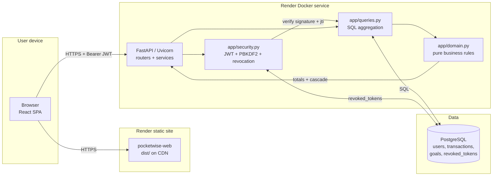
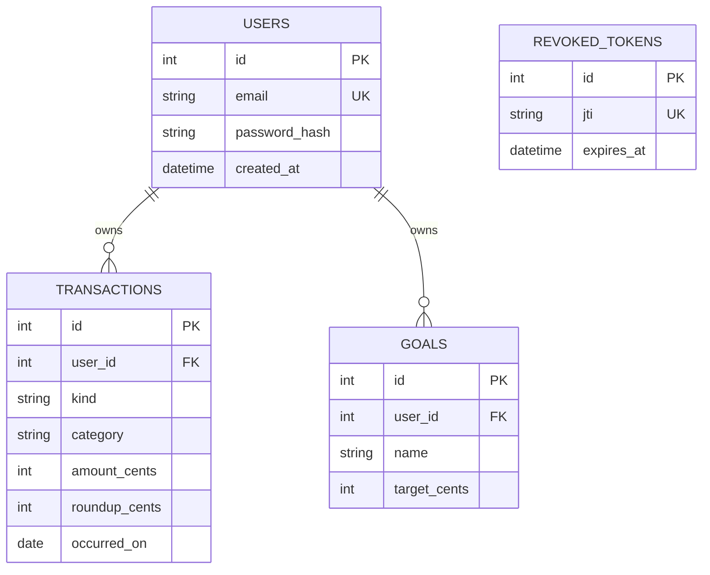

# PocketWise: Automated Micro-Saving for Student Budgeting

**Final project report — Web Systems Engineering**

---

## 1. Introduction

Most personal finance advice is delivered as information. Students are told to budget, to track spending, to save a fixed percentage of income. The advice is sound and largely ineffective, for a reason that has little to do with the quality of the guidance: budgets are formulated as intentions, and intentions are fragile. A spreadsheet is a recurring task, and recurring tasks are abandoned.

This project builds **PocketWise**, a web application that converts saving from an intention into a by-product of an action the user was going to take anyway. Every expense is charged to the next whole euro, and the difference is redirected into a savings pot that fills savings goals automatically. A €12.50 purchase is recorded as €13.00, and €0.50 is redirected. The user does not decide to save; the system saves on their behalf, and the visible cost of doing so is approximately one euro.

The choice is deliberate. Saving from spare change sounds trivial, and the amount involved is genuinely small. The design rationale is not that the sums are large, but that the *friction is removed entirely*. The intervention targets the point at which most budgeting attempts fail — the moment a decision is required — by removing the decision rather than by improving the information supporting it.

## 2. Background and Literature Review

### 2.1 The problem is a behavioural one, not a knowledge one

The OECD/INFE International Survey of Adult Financial Literacy (2023) and its companion report on students (OECD, 2024) establish an uncomfortable gap: on average across OECD countries, **18% of students are low performers in financial literacy**, yet roughly **80% of students report feeling confident** in their ability to manage their money. Self-assessment is not a reliable proxy for capability.

This matters for intervention design. If students believed they were managing money poorly, the obvious response — education — would be appropriate. The confidence gap explains why it underperforms. Rodríguez-Correa et al. (2025), in a PRISMA systematic review of 44 peer-reviewed studies on financial literacy among young college students, find that knowledge interventions produce measurable but modest and decaying effects. Gerrans et al. (2021) report the same decay pattern: students retain significant objective and subjective literacy gains after a financial literacy unit, but the effect diminishes over the following three years.

The consensus in this literature is that **knowledge decays faster than the financial habits it is meant to support**. An intervention that requires the user to recall a rule, at the moment of transaction, competes against immediate friction.

### 2.2 Why automation and defaults work

Behavioural economics provides the mechanism. Montier (2000) documents the consistent tendency to treat money in psychologically distinct categories — mental accounting — and to value small, immediate losses more heavily than large, deferred ones. Thaler (1988) showed that people systematically overestimate small probabilities of large losses, which explains why insurance is chronically under-purchased.

The practical implication is that defaults are powerful precisely because they do not compete for willpower. Madrian and Shea (2001) demonstrated that participation in workplace savings plans is determined almost entirely by enrolment defaults rather than by participant preference. Blumenstock et al. (2018) replicated and extended this finding in a field experiment in Afghanistan, showing that the *design* of the default — not merely its existence — drives take-up.

Most directly relevant to this project, **Choi et al. (2024)** analysed nine natural experiments on automatic savings policies and found that automatic enrolment increases steady-state saving rates by approximately **0.6% of income**, with a further 0.2% from related auto-deposit mechanics. The authors' framing in the title — "Smaller Than We Thought?" — is a useful corrective, and this project adopts it as an honesty constraint: automatic savings reliably works, but its measured effect is modest. A design that claimed otherwise would not survive scrutiny.

### 2.3 Round-up saving as an established pattern

The round-up mechanism is not novel. Bank of America launched **"Keep the Change"** in 2005, rounding card purchases to the next dollar and transferring the difference to savings accounts; the model has since been adopted by several European and North American banks and fintech applications.

The academic evidence on round-up specifically is thinner than the evidence on automation in general, which is itself a finding worth stating: the mechanism is well-validated at the level of *automation* and *defaults*, and largely untested at the level of the *specific arithmetic* of rounding. PocketWise is therefore not a novel saving mechanism but a deliberately minimal implementation of a validated behavioural principle, targeted at a population (students) for which the problem is documented and the existing interventions are documented to decay.

### 2.4 Positioning

PocketWise occupies a specific point: it does not attempt to replace budgeting, it attempts to make budgeting *survivable* by removing the single most fragile moment from it. Where Acorns and similar services then sweep accumulated change into investments, PocketWise keeps the output as cash against user-defined goals — appropriate for a user whose immediate problem is a €600 emergency fund, not a portfolio.

## 3. Requirements

Derived from the problem analysis, the system must:

1. **Record transactions with minimal friction** — a single expense entry must be possible in seconds, on a phone, without navigating a multi-step form.
2. **Apply round-up savings automatically** — the user never performs a separate saving action.
3. **Make accumulated savings concrete** — savings must be attached to named goals with visible progress, since abstract balances are not motivating (loss aversion, present bias).
4. **Never corrupt monetary arithmetic** — rounding errors are unacceptable in a financial tool.
5. **Protect financial data** — the application handles a transaction history; confidentiality and integrity are not optional.
6. **Deploy to a public cloud** and be demonstrable.

Requirement 4 deserves emphasis. Naïve floating-point currency arithmetic (`0.1 + 0.2 != 0.3`) introduces errors that are individually trivial and cumulatively material across thousands of transactions. For a system whose central value proposition *is* a repeated rounding calculation, this is a correctness requirement, not a performance one.

## 4. System Design

### 4.1 Architecture

The system is a three-tier browser application deployed as two independent artifacts on Render: a static single-page application served from a CDN, and a containerised REST API backed by managed PostgreSQL.



The client speaks directly to the API rather than proxying through the static site. This keeps the API independently scalable and means the static artifact can be cached aggressively at the edge.

### 4.2 Design decisions

Full decision records (ADR-001 to ADR-010) are in `docs/architecture.md`. The four that most shape the system:

**Money is stored as integer cents, end to end.** No `float` appears in any monetary path — schema, model column, or business function. Division by 100 occurs only at render time in the client. This directly discharges requirement 4.

**Savings are a derived state, not a stored balance.** No savings balance is persisted. The total is recomputed by SQL aggregation on every read and distributed across goals by a cascade function. This was a deliberate trade: an incremental balance is faster to write, but it introduces an invariant that every create, update and delete must maintain, and that invariant will eventually be violated. Storing only facts means deleting an expense automatically reduces goal progress with no compensating logic to get wrong. The cost is a per-user aggregation on read, which the composite index `(user_id, occurred_on, id)` covers.

**Business rules live in an I/O-free module.** `app/domain.py` imports only `collections`, `dataclasses`, `enum` and `typing`. The round-up formula, the cascade allocation and the summary arithmetic are total functions with no side effects. This makes the most valuable logic testable without a database, an HTTP client or heavy fixtures, and the module reaches 100% test coverage as a direct consequence. The boundary is enforced as a review rule: any function in `domain.py` that needed a session would be, by construction, in the wrong module.

**Round-ups are never applied to income.** `savings_from` returns zero for a credit, and a database `CHECK` constraint prevents a non-zero round-up on income rows. Applying savings to income would be a silent double-count.

### 4.3 Core mechanics

The round-up is `-amount_cents % 100`: an already-round amount yields zero, matching the established convention that a payment the user rounded themselves generates nothing. Debited expense is `amount_cents + roundup_cents`; savings is reported as a *component of* that debit, not an addition to it — summing both would count the same money twice.

Total savings are distributed across goals in creation order, oldest first. A filled goal does not overflow into the next; once all goals are satisfied the remainder is surfaced as `unallocated_savings_cents` rather than silently discarded.

### 4.4 Data model



All user-owned rows cascade on user deletion. `revoked_tokens` is deliberately global rather than user-scoped, and self-prunes: rows are removed once the token's natural expiry has passed.

## 5. Implementation

The backend is FastAPI with SQLAlchemy 2.0. Layering is enforced by module responsibility rather than by framework: `routers/` handle HTTP concerns only, `queries.py` owns SQL, `services.py` coordinates, and `domain.py` holds pure rules.

Authentication uses HS256 JWTs with a 12-hour lifetime, carrying `sub`, `iat`, `exp`, `iss` and `jti`. All five claims are verified on decode, and the issuer is checked. Because stateless JWTs cannot be revoked, logout is implemented with a database denylist indexed on `jti`; without it, a stolen bearer token would remain valid for its full lifetime and client-side logout would have no server-observable effect.

Password hashing uses PBKDF2-HMAC-SHA256 at 600,000 iterations with a per-password random salt. The hash embeds its own iteration count in a versioned format, so raising the work factor is a routine operation: a legacy 200,000-iteration hash is accepted at login and immediately rewritten. Argon2id would offer stronger GPU resistance, and this is a conscious trade recorded in ADR-007 — PBKDF2 is in the standard library and therefore introduces no native dependency to compile in a slim container, whereas an adjustable, auditable iteration count remains a cost an attacker cannot avoid by changing hardware.

The frontend is a hand-written React SPA built with Vite, with no router. Authentication state lives in `sessionStorage` and is lifted to the root component; since the token's location already forces the application to track auth state globally, a routing library would add configuration for two states. This is a bounded decision — it is the first thing to reverse should the product grow.

## 6. Security

`docs/security.md` contains the full threat model. Summary of implemented controls:

- **Password storage** — PBKDF2, 600k iterations, constant-time comparison via `hmac.compare_digest` to avoid timing leakage.
- **Credential enumeration** — login returns an identical message and status for an unknown account and a wrong password, and both are rate-limited.
- **Rate limiting** — a sliding-window limiter, 10 login attempts per 15 minutes per IP and 5 registrations per hour per IP. A sliding window was chosen over a fixed-reset counter because the latter permits two bursts of N requests at the window boundary.
- **Token hygiene** — validation errors are rebuilt from an allow-list of fields. FastAPI echoes Pydantic's error payload by default, which includes `input` — the plaintext password — and that would otherwise land in browser history, proxy logs and any intermediary gateway.
- **Transport and headers** — HSTS, `X-Content-Type-Options`, `X-Frame-Options: DENY`, `Referrer-Policy: no-referrer`, and a restrictive `Permissions-Policy`.
- **CORS** — an explicit per-environment origin allow-list; credentials are not permitted, so the wildcard default is not usable.
- **Fail-closed configuration** — a missing or short `SECRET_KEY` aborts the process at import rather than signing with a published default.
- **Audit logging** — an allow-listed structured log of security and financial events. An event outside the allow-list raises, so adding a field that leaks a secret requires an explicit code change and review.

**Residual risks, stated honestly.** The rate limiter is in-process memory: state is per-instance, so horizontal scaling doubles the effective limit, and counters do not survive restart. The extension path is a shared store behind the same `check(key)` interface, with the sliding-window algorithm ported unchanged via an atomic Lua script. Behind a proxy, `request.client.host` may identify the proxy rather than the client unless proxy trust is aligned with this choice. Audit logs are text on stdout, adequate for Render but not tamper-evident as a compliance record.

## 7. Testing and Continuous Integration

The suite comprises 72 tests across four modules covering authentication, domain logic, transactions and goals. Current coverage is **93.3%**, against a CI-enforced threshold of 85%.

The test strategy follows the architecture rather than the endpoints. Domain rules are tested as pure functions with no fixtures; router and query behaviour is tested through the HTTP layer against an in-memory SQLite database shared via `StaticPool`, so the suite is executable with no external dependency. Coverage is enforced as a hard gate — a regression below threshold fails the build rather than producing a report nobody reads.

Static analysis runs alongside tests: `ruff` for lint and formatting, `mypy` in strict mode for type correctness, and `pip-audit` for dependency vulnerabilities. All pass with no findings. Dependency pins are exact rather than ranged, and Starlette is pinned explicitly despite being a FastAPI transitive dependency, because a floating transitive dependency is a dependency not under the project's control.

Testing during development surfaced a genuine production defect: `security.py` and `rate_limit.py` imported the `audit` *function* while calling `audit.audit(...)`, an attribute access on a function object. Logout and rate-limit enforcement therefore raised `AttributeError` and would have returned HTTP 500 in production. Three tests failed and exposed it. The lesson reinforced ADR-005 — the value of a layered design is that defects surface in cheap, obvious places rather than in production traffic.

## 8. Cloud Deployment

Deployment is defined declaratively in `render.yaml` (Render Blueprint) and is reproducible from the repository: an application blueprint plus a managed PostgreSQL 16 instance, with the API deployed as a Docker image built from `backend/Dockerfile`.

Configuration is environment-driven throughout. The database connection arrives as `DATABASE_URL`, normalised at a single point to accommodate Render's historical `postgres://` prefix, which SQLAlchemy 2 rejects. `SECRET_KEY` is generated by the platform rather than committed. `ENVIRONMENT=production` disables the OpenAPI endpoints and schema browsing. The frontend receives `VITE_API_URL` at build time.

Schema changes are managed by Alembic, applied by the container entrypoint before Uvicorn starts. This is deliberate and important: `create_all` cannot alter an existing table and would silently freeze the schema at first boot, which is a failure mode that appears weeks later, in production, with no error message.

Two deployment constraints are documented rather than hidden. The free PostgreSQL plan is a 30-day trial and Render deletes instances after 30 days of inactivity, taking the API down; a paid plan is required for durability. The in-process rate limiter means the service must run as a single instance at this scale.

## 9. Discussion and Limitations

Honest evaluation requires separating what was demonstrated from what was not.

**Demonstrated.** A working, deployed, tested application with a public URL; 72 passing tests at 93.3% coverage; clean static analysis; a documented architecture with ten recorded decisions; a reproducible infrastructure definition.

**Not demonstrated, and material to the research question.** The central hypothesis — that round-up saving changes behaviour for this population — is **not validated by this project**. The system was evaluated for engineering correctness and deployability, not for behavioural efficacy. No user study was conducted, and the cited evidence concerns populations and mechanisms that are adjacent to, not identical with, university students using a web round-up tool.

The most likely limitation of the mechanism is its arithmetic. Choi et al. (2024) put the measured effect of automatic saving at roughly 0.6% of income; the round-up component alone is smaller. A student spending €400 monthly with an average round-up of €0.30 accumulates roughly €10–12 monthly, or about €120–145 annually — meaningful against a €600 emergency fund, negligible against a €2,400 laptop. The honest framing is that PocketWise is an *initiator* mechanism: it establishes a saving habit at near-zero cost and builds a visible pot, rather than a strategy for material wealth accumulation.

**Future work**, in priority order: replace the in-process rate limiter with a shared store before any horizontal scaling; add a monthly aggregate table if per-user history grows enough for on-read aggregation to dominate; introduce a password-change endpoint and account deletion, both currently absent and both required in practice; and run a genuine user study, which would convert the project's strongest borrowed evidence into its own.

## 10. Conclusion

PocketWise demonstrates that the fragility of student saving behaviour is an engineering problem as much as an educational one. By removing the decision rather than by improving the information supporting it, and by attaching abstract savings to concrete goals, the system applies well-established findings on defaults and mental accounting to a population where conventional interventions are documented to decay.

The engineering reinforced the argument. Isolating pure business rules made the most valuable logic testable in isolation and directly enabled the discovery of a production-breaking authentication defect. Storing only facts and deriving savings state made deletion correct by construction. Integer-cent arithmetic discharged the one correctness requirement that could not be compromised.

The result is a deployed, tested, documented system that solves a real problem within honest limits — and that states those limits rather than concealing them.

---

## References

1. Bank of America. (2005). *Keep the Change* savings programme.
2. Blumenstock, J., Callen, M., Ghani, E., & Shapiro, I. (2018). Why do defaults affect behavior? Experimental evidence from Afghanistan. *J-PAL*, JPALW-833.
3. Choi, J. J., et al. (2024). *Smaller than We Thought? The Effect of Automatic Savings Policies*. Harvard Business School working paper.
4. Gerrans, P., et al. (2021). Undergraduate student financial education interventions. *Journal of Financial Economics*.
5. Madrian, J. C., & Shea, M. L. (2001). The power of suggestion and inertia in 401(k) participation decisions. *Economics of Aging*.
6. Montier, J. (2000). *Behavioral Finance: Psychology, Decision Making, and Markets*. Wiley.
7. OECD/INFE. (2023). *International Survey of Adult Financial Literacy 2023*. OECD Publishing.
8. OECD. (2024). *Shaping Students' Financial Literacy: The Role of Parents and Other Influences*. OECD Publishing.
9. Rodríguez-Correa, P. A., et al. (2025). Financial literacy among young college students: a systematic literature review. *PMC*.
10. Thaler, R. H. (1988). The Winner's Curse. *Journal of Economic Perspectives*.

---

## Appendix A — Project structure

| Path | Contents |
|---|---|
| `backend/app/domain.py` | Pure business rules (round-up, cascade, totals), no I/O |
| `backend/app/security.py` | PBKDF2 hashing, JWT issue/verify, revocation |
| `backend/app/routers/` | HTTP layer: auth and ledger endpoints |
| `backend/tests/` | 72 tests, 93.3% coverage |
| `backend/alembic/` | Schema migrations |
| `frontend/src/` | React SPA (auth, dashboard) |
| `docs/architecture.md` | ADR-001 to ADR-010 |
| `docs/security.md` | Threat model and residual risks |
| `.github/workflows/ci.yml` | Tests, coverage gate, lint, type check, audit |
| `render.yaml` | Deployment blueprint |

## Appendix B — Reproduction

```bash
# Backend
cd backend
python -m venv .venv && .\.venv\Scripts\Activate.ps1
pip install -r requirements-dev.txt
python -m alembic upgrade head
uvicorn app.main:app --env-file .env --reload

# Frontend
cd frontend
npm ci && npm run dev
```

Verification: `pytest` (72 passed), `ruff check .`, `ruff format --check .`, `mypy app scripts`.
